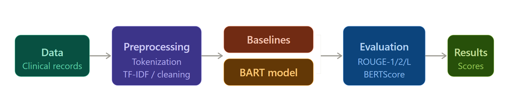
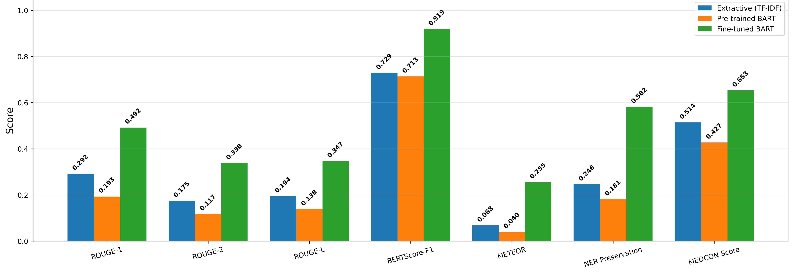
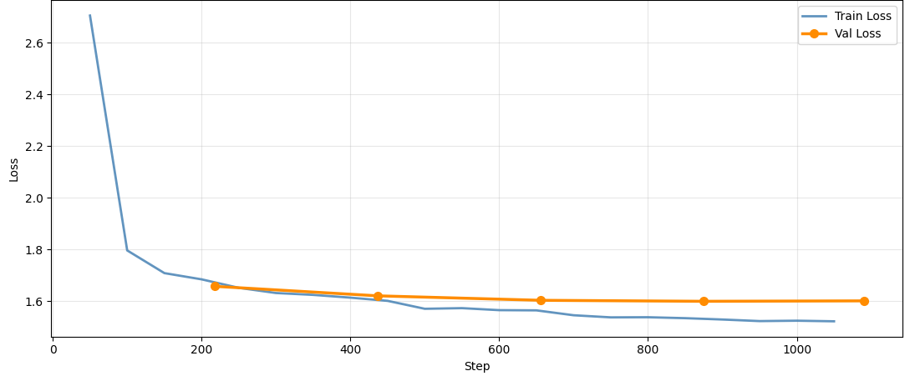
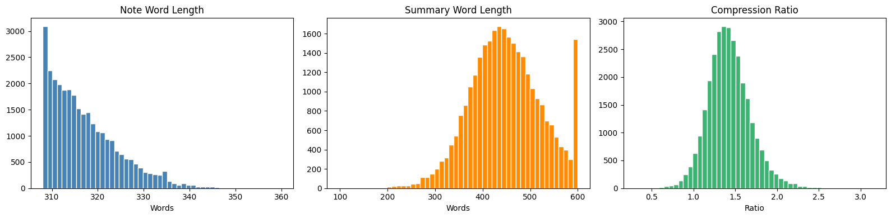

<div align="center">

# Clinical Note Summarization

**Fine-tuned BART-large-cnn that turns unstructured clinical notes into structured JSON-style summaries.**


[Overview](#-overview) · [Pipeline](#-pipeline) · [Results](#-results) · [Training](#-training) · [Limitations](#-limitations) · [Usage](#-usage) · [Structure](#-project-structure)

</div>

<br>

## 🩺 Overview

Clinical notes are long and unstructured, so manual review is slow. This project fine-tunes BART to produce a structured summary covering the visit motivation, patient information, history, symptoms, diagnosis and treatment.

Three systems are compared on the same notes: a TF-IDF extractive baseline, zero-shot BART-large-cnn and the fine-tuned BART-large-cnn. Evaluation uses standard summarization metrics alongside clinically oriented proxies.

|  |  |
|---|---|
| **Dataset** | [AGBonnet/augmented-clinical-notes](https://huggingface.co/datasets/AGBonnet/augmented-clinical-notes), 30,000 notes |
| **Sample** | 5,000 notes (seed 42), split 3,500 / 750 / 750 |
| **Model** | `facebook/bart-large-cnn`, 406,290,432 parameters |
| **Input / target** | 512 / 384 tokens |
| **Hardware** | 2 x Tesla T4 (Kaggle) |
| **Paper** | *NLP Based Patient Record Summarization for Clinical Decision* |

<br>

## 🔬 Pipeline

<p align="center">
  
</p>

TF-IDF is a separate baseline. Its output is not fed into BART.

<br>

## 📊 Results

Evaluated on the first 50 notes of the 750-note test split.

| Model | R-1 | R-2 | R-L | BERT-F1 | METEOR | NER | MEDCON | Factual |
|---|:---:|:---:|:---:|:---:|:---:|:---:|:---:|:---:|
| TF-IDF extractive | 0.2918 | 0.1751 | 0.1936 | 0.7291 | 0.0684 | 0.2459 | 0.5143 | 1.0000 |
| BART zero-shot | 0.1926 | 0.1169 | 0.1384 | 0.7128 | 0.0395 | 0.1814 | 0.4268 | 0.9995 |
| 🥇 **BART fine-tuned** | **0.4922** | **0.3381** | **0.3470** | **0.9187** | **0.2546** | **0.5818** | **0.6531** | 0.5802 |

Fine-tuning lifts ROUGE-1 from 0.19 to 0.49 over the zero-shot model and BERTScore F1 from 0.71 to 0.92.

<p align="center">
  
</p>

<details>
<summary><b>How each metric was computed</b></summary>

<br>

| Metric | Method |
|---|---|
| ROUGE-1 / 2 / L | `rouge-score` |
| BERTScore | `distilbert-base-uncased` |
| METEOR | NLTK |
| NER preservation | Regex keyword fallback, because the scispaCy `en_core_sci_sm` model failed to load |
| MEDCON | Custom lexicon of about 150 medical terms with substring matching |
| Factual consistency | Token overlap with the source note, used as a proxy |

</details>

<br>

## ⚙️ Training

| Setting | Value |
|---|---|
| Learning rate | 3e-5, cosine schedule, 131 warmup steps |
| Batch | 2 per device, gradient accumulation 4 |
| Epochs | Up to 5, early stopping with patience 2 |
| Regularization | Label smoothing 0.1, weight decay 0.01 |
| Precision | fp16 |
| Runtime | 5,777.6 s |
| Final train loss | 1.6406 |

Inference uses 4 beams, length penalty 1.2, `no_repeat_ngram_size=3` and 80 to 384 new tokens.

<p align="center">
  
</p>

<details>
<summary><b>Dataset length statistics</b></summary>

<br>

Median note length is 316 words and median summary length is 446 words, a compression ratio of 1.41. Summaries are longer than the notes because they follow a fixed structured schema.

<p align="center">
  
</p>

</details>

<br>

## ⚠️ Limitations

> [!IMPORTANT]
> The numbers above come from a 50-note subset and several proxy metrics. Read them as a comparison between the three systems, not as clinical validation.

- **Small evaluation set.** Scores use 50 of the 750 test notes.
- **Proxy metrics.** NER preservation and MEDCON are keyword and lexicon approximations. Factual consistency is token overlap, so the extractive baseline scores near 1.0 because it copies text from the source.
- **Invalid JSON.** Fine-tuned outputs often contain malformed JSON, such as missing colons or mismatched quotes. See `results/sample_predictions.txt`.
- **Weights not included.** The fine-tuned checkpoint was not recovered, so only the code and logged results are here.
- **Run settings.** The effective batch size was probably 16 across two GPUs. The cosine schedule was planned for 2,185 steps but about 1,095 ran. Both points are inferred from the logs.

<br>

## 🚀 Usage

```bash
git clone https://github.com/aniiiket08/clinical-note-summarization.git
cd clinical-note-summarization
pip install -r requirements.txt
python src/finetune_and_evaluate_bart_clinical_summarizer.py
```

A GPU is needed for fine-tuning. The script follows the notebook top to bottom and installs its own pinned packages at the start. To see the original run with saved outputs, open `notebook/clinical_summarization_bart_finetune.ipynb`.

<br>

## 🧰 Tech stack

Python, PyTorch, Hugging Face Transformers, Datasets, Accelerate, scikit-learn, NLTK, rouge-score, bert-score, pandas, matplotlib, seaborn

<br>

## 📁 Project structure

```
.
├── src/
│   └── finetune_and_evaluate_bart_clinical_summarizer.py
├── notebook/
│   └── clinical_summarization_bart_finetune.ipynb   original Kaggle run with outputs
├── results/
│   ├── evaluation_results_50_test_notes.csv         final metric table
│   ├── training_log.csv                             train and validation loss
│   └── sample_predictions.txt                       qualitative samples
├── figures/
├── paper/
│   └── IEEE_paper_clinical_note_summarization.pdf
├── requirements.txt
└── README.md
```

<br>

